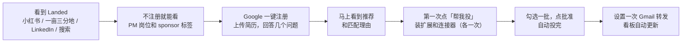
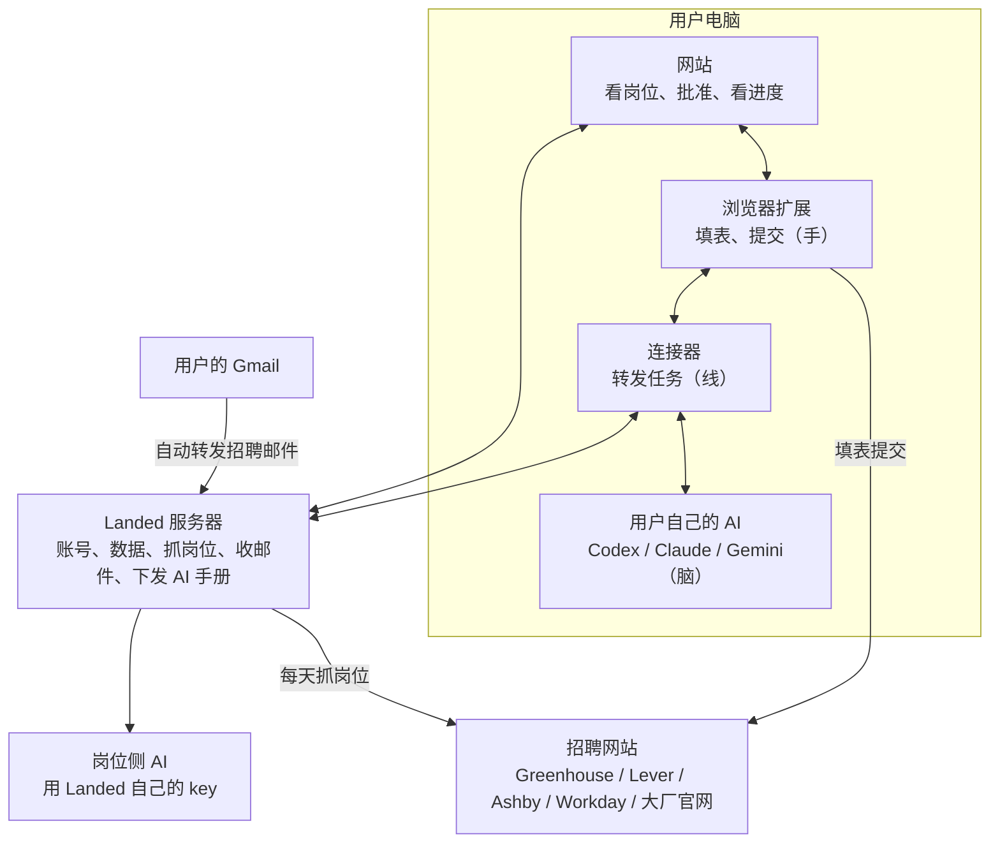
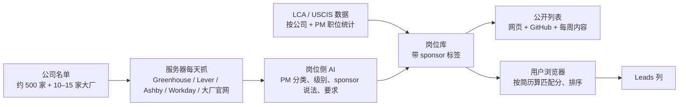
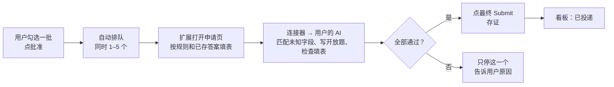
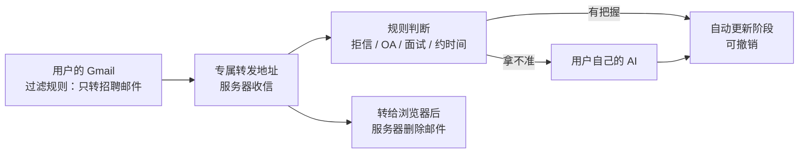

# Landed two：产品说明

这份文档讲清楚 Landed two 是什么、为谁解决什么问题、用户怎么用、整体怎么搭、技术上怎么实现，以及接下来按什么顺序做。写给团队里的每个人，包括不写代码的人。

- 这是**产品方向的唯一依据**：建 issue、提 PR、做取舍时，先对照这里。
- 现在代码具体是怎么运转的，看 [architecture.md](architecture.md)。那份写的是当前代码；两份不一致的地方，以这份为目标，代码按"开发路线"一步步改过来。
- 改这份文档里的产品决定，需要和负责人确认，并在同一个 PR 里更新 [CLAUDE.md](../CLAUDE.md)。

最后更新：2026-11-06

---

## 1. 一句话

**帮找 PM 和 AI PM 工作的人，找全适合自己的岗位，用最合适的那份简历自动投出去，之后的进展自动更新到看板。需要签证的人，还能一眼看出哪些岗位可能 sponsor。**

---

## 2. 我们解决什么问题

找 PM 工作的人，不管是在校生、应届生还是在职跳槽，都会遇到这些事：

| 痛点 | 现在怎么办 | 结果 |
|---|---|---|
| **PM 岗位散落在各处** | Simplify、Jobright、LinkedIn、公司官网轮流刷 | 漏掉岗位，尤其是小公司和刚开放的岗位 |
| **每份申请都要重新填一遍表** | 手动复制粘贴，或用只会填基础信息的插件 | 一天投不了几份；投得多了容易填错 |
| **开放题很耗时**（Why PM、Why this product） | 自己写，或用 AI 生成通用答案 | 要么慢，要么答案空泛甚至编造经历，一眼被看出来 |
| **一份简历投所有岗位** | 懒得为每个岗位改简历 | AI PM、增长 PM、技术 PM 看重的东西不一样，匹配度低 |
| **投完不知道进展** | 自己记 Excel，翻邮箱找回信 | 错过 OA 截止时间和面试邀请 |
| **找人代投很贵** | 花几百到上千美元请代投服务 | 贵，而且看不到具体投了什么 |
| **需要签证的人：不知道哪些公司会 sponsor PM** | 一家家查 MyVisaJobs、翻 JD、问学长学姐 | 查的时间比投的时间还长；很多公司只给工程师办 H-1B，不给 PM 办，只看公司层面的数据会误判 |

Landed two 把这些串成一条线：**找到适合的岗位 → 你批准 → 自动投 → 自动跟进度。**

---

## 3. 为谁做

### 目标用户

**在北美找 PM 和 AI PM 工作的人**，实习、New Grad、社招都做。用户也可以勾选相邻职位：Product Analyst、Product Ops、TPM、PMM、Strategy / BizOps。

主要有这几类人：

| 人群 | 特点 | 对他们最有用的 |
|---|---|---|
| **在校生和应届生** | 投实习、New Grad、APM 项目；岗位多、截止快 | 岗位找全、投得快、开放题写得好 |
| **需要签证的留学生** | F-1 学生，或正在 OPT / STEM OPT 期间，以后要办 H-1B | 以上全部，**再加 sponsor 和 E-Verify 标签**。这是我们相对通用产品最大的卖点之一，也是最早的种子用户（华人留学生社群好触达） |
| **在职跳槽的 PM** | 时间少，只想投合适的岗位 | 按方向挑岗位、按岗位选简历，批准后不用管 |
| **转行做 PM 的人** | 从工程、咨询、运营、设计转过来 | 简历按 PM 的写法重新组织（不编造，只换表达） |

**sponsor 是一个功能和卖点，不是门槛。** 不需要签证的用户照样能用全部功能，只是不用看那几个标签。

**地区**：先做北美。sponsor 数据目前只覆盖美国。国内岗位以后再说。

**语言**：界面英文为主，可以切换成中文。获客上，华人社群（小红书、一亩三分地、微信群）是早期重点渠道之一，但不是唯一渠道。

### 典型场景

1. **秋招（8 月到 11 月）**：投暑期实习、New Grad 和 APM 项目。岗位多、截止快，最需要"别漏掉"和"投得快"。
2. **春季补招（12 月到次年 4 月）**：秋招没拿到 offer 的人继续投 off-cycle 岗位和小公司。这时候的岗位以初创和中小公司为主。
3. **在职跳槽**：随时都在发生。用户只想每周看一眼新岗位，挑几个批准，剩下的交给 Landed。
4. **OPT 期间找工作**：已经毕业、OPT 在倒计时的人。最着急，愿意多投，也会投写着"不 sponsor"的岗位，先工作起来再说。
5. **签证身份下跳槽**：拿着 H-1B 或 STEM OPT，想换一个 PM 岗位，只关心新公司能不能接着办身份。

### 为什么先只做 PM

**聚焦 PM 换来的是"准"，不是"快"。** 投得快是自动投递本身带来的，做 PM 和做 SWE 都一样快。

- **岗位能找全**：PM 岗位少，几百家公司、每年的 APM 项目日历，我们都盯得住。
- **申请能写好**：PM 申请特别看重文字。我们专门针对 PM 的开放题和简历写法做优化。
- **sponsor 判断能细到职位**：别人的标签停在"这家公司办过 H-1B"，我们能做到"这家公司过去 3 年给 PM 办过几次"。
- **用户好找、好讲**：PM 求职者有清楚的社群（学校 PM 社团、PM 求职社区、华人留学生社群），好做内容，也容易口口相传。

代价是市场小。所以 PM 是切入点，不是终点：先在这个人群里做到最好，再扩到相邻职位。

---

## 4. 竞品和我们的不同

| 竞品 | 它做什么 | 值得学的 | 我们的不同 |
|---|---|---|---|
| **Jobright** | 匹配分、免费的 H-1B 筛选、按岗位改简历、内推人脉、AI 助手；**已经在 GitHub 上发 PM 实习和 New Grad 岗位列表** | sponsor 筛选免费；推荐要说理由 | 专注 PM，岗位更全、申请写得更好；sponsor 细到职位，不只看公司；绝不编造（Jobright 改简历时被用户批评编造经历）；真正自动提交 |
| **Simplify** | 免费填表扩展；填完自动进追踪表；GitHub 岗位列表（也有 PM 分类）；付费版每周约 20 次自动投递 | 填完自动进看板；免费基础功能 | 批准一批就全自动投完，免费、不限总数（只有防风控的每日上限）；有 sponsor 标签 |
| **海投工具**（JobCopilot、LazyApply 等） | 一天投几十上百个 | 反面教材：一份简历投所有岗位、答案乱填，口碑很差 | 每个岗位挑合适的简历，答不了就停下，不瞎填 |
| **签证工具**（MyVisaJobs、Interstride 等） | sponsor 雇主名单 | 签证数据要细 | 不只给名单，还帮你投 |
| **代投服务**（Rexpand 睿思班、scale.jobs） | 人工帮你投，几百到上千美元 | 每份申请都给你看结果；用户愿意为"省事"付钱 | 自动化，免费，每份都能查到 |

我们的位置：**PM 求职者的"自动代投"：岗位找得全、简历选得对、批准后全自动投完、每份都投得像认真写的；需要签证的人，还能看到职位级别的 sponsor 信息。**

注：以上竞品信息来自 2026 年 11 月的公开评测，价格和功能会变。

---

## 5. 用户怎么用（用户旅程）

原则：**先让用户看到价值，需要安装的东西等用户真要用的时候才出现。**

1. **看到 Landed**：通过任何渠道打开网站，**不用注册**就能看 PM 岗位列表和 sponsor 标签。
2. **注册**：Google 一键登录，上传简历，回答几个问题：
   - 找实习、New Grad 还是社招？
   - 需不需要签证 sponsor？（不需要的人直接跳过；需要的话，再问是不是在 OPT / STEM OPT 期内）
   - 想去哪些城市？要不要看相邻职位？
   - 有没有 ChatGPT Plus 或 Claude Pro？用 Mac 还是 Windows？
3. **马上看到推荐**：匹配分，加上理由，比如"JD 要求的 A/B 测试和 SQL 你的简历里都有"；需要签证的用户还会看到"这家公司去年给 PM 办过 4 次 H-1B"。到这一步都不用装任何东西。
4. **第一次点"帮我投"**：这时才提示装浏览器扩展和连接器，各装一次。连接器会引导用户连上自己的 Codex 或 Claude。
5. **之后**：勾选一批岗位，点"批准"，自动投完。全自动的直接提交；需要登录的岗位（大厂官网、大多数 Workday），我们填好后由用户自己点提交。
6. **可选**：设置一次 Gmail 转发，之后面试邀请、OA、拒信都会自动更新到看板。

用户真正需要动手的只有：注册、上传简历、装一次扩展和连接器。

---

## 6. 功能

现阶段 **Landed 的所有功能免费**。用到 AI 的功能（读简历、改简历、写开放题、检查填表）用的是用户自己的 ChatGPT 或 Claude 订阅；没有订阅也能用岗位推荐、标签、看板和基础填表。

### 做的五件事

1. **岗位推荐**
   - PM 岗位（加上用户勾选的相邻职位），每天更新。
   - 每个岗位都有匹配分，并说明推荐理由。
   - 需要签证的用户还会看到 sponsor 标签（见下方）；不需要的用户可以关掉这些标签。
   - 岗位状态：开放中 / 已关闭 / 即将开放（大厂 APM 项目日历）。
2. **批准后自动投**
   - 勾选一批，点"批准 N 个"，自动排队，同时投 1 到 5 个。
   - **全自动**：Greenhouse、Lever、Ashby，以及其他不需要登录就能投的申请表。
   - **半自动**：需要登录或注册账号的岗位，包括大厂官网和大多数 Workday 岗位。我们打开页面、填好表，用户登录后自己点提交。
   - 遇到验证码、需要登录、答不了的题，只有那一个停下来等你，其他的继续投。
   - 每天有投递上限，默认 30，用户可以改。
   - 每投完一个，存下提交成功的证据：成功页的文字、网址和时间，能截图时附上截图。
3. **看板和邮件跟踪**
   - 阶段：Leads → Applied → OA / Test → Interview → Offer → Rejected。
   - 投完自动进看板。
   - 设置 Gmail 转发后，有把握的邮件自动更新阶段，拿不准的先问你。
4. **简历管理**
   - 一份总简历，按方向生成不同版本，比如偏 AI PM、偏增长、偏技术。
   - 每个岗位自动选用最合适的版本。
   - **绝不编造**任何经历、数字或技能。
5. **开放题回答**
   - 根据你的简历和这个岗位来写，针对 PM 常见题优化。
   - 写完由 AI 再检查一遍，有编造的不用。
   - 写不出真实答案就留空，并告诉你。

### sponsor 标签

| 标签 | 意思 | 依据 |
|---|---|---|
| 🟢 **sponsor 过** | 这家公司过去 3 年给 PM 类职位办过 H-1B，并写出次数 | 美国劳工部 LCA 数据、USCIS H-1B 雇主数据 |
| 🔴 **JD 写明不 sponsor** | 岗位描述里明确说不提供 sponsor | JD 原文 |
| ⚪ **没有记录** | 数据里查不到。**不等于不 sponsor**，小公司经常是这种情况 | — |
| ✅ **E-Verify 雇主** | STEM OPT 只能去 E-Verify 雇主 | 待确认能否批量获取数据，拿不到就先放官网查询链接 |

默认不隐藏"JD 写明不 sponsor"的岗位，只打标签：很多在 OPT 期内的人也会投这些岗位。需要签证、又不想看这些岗位的用户，可以自己打开"隐藏写明不 sponsor 的岗位"。

### 不做的事

| 不做 | 原因 |
|---|---|
| Agent 聊天页 | 和"批准后自动投"的核心无关 |
| 完整的 Mac 应用（菜单栏等） | 换成一个轻量的连接器，Mac 和 Windows 都支持 |
| Cloud agents（ChatGPT、Claude 网页版接入） | 用户自己电脑上的 agent 就够用，少一套系统要维护 |
| 招聘网站状态检查 | 用邮件跟踪代替 |
| 批量抓 LinkedIn、在 LinkedIn 上自动投 | LinkedIn 禁止抓取，会封号。改为用户在 LinkedIn 上浏览时，扩展提供"存到 Landed"按钮 |
| 内推人脉 | 以后再做（见开发路线） |
| 国内岗位 | 以后再做 |

### 红线（任何时候都不能做）

- **不编造**：简历、开放题、任何回答，都只能用用户真实的经历。
- **sponsor 题如实回答**："Will you now or in the future require sponsorship?" 按用户的真实情况填，不替用户撒谎。
- **只投批准过的**：用户只是浏览、保存过的岗位，绝不提交。
- **不绕过验证码，不存招聘网站的密码。**
- **敏感信息不发给 AI**：EEO、生日、证件号、薪资、同意条款。

---

## 7. 产品架构：由哪几块组成

| 部分 | 做什么 | 打个比方 |
|---|---|---|
| **网站** | 用户看岗位、点批准、看进度、管简历的地方 | 前台 |
| **浏览器扩展** | 在招聘网站上填表、提交 | 手 |
| **连接器** | 装在用户电脑上，把需要 AI 的活转给用户自己的 AI | 线 |
| **用户自己的 AI** | 读简历、改简历、写开放题、检查填好的表 | 脑子 |
| **服务器** | 账号、数据、每天抓岗位、收转发的邮件、给连接器下发"AI 工作手册" | 后台 |
| **岗位侧 AI** | 判断是不是 PM 岗、识别 sponsor 说法、抽取岗位要求 | 后台的分析员 |

### AI 分两边跑

- **岗位这边**：处理的是公开的岗位信息，不涉及任何用户数据。每个岗位只跑一次，所有用户共享结果。用 **Landed 自己的 API key** 在服务器上跑，成本低，质量统一。
- **用户这边**：读简历、写开放题、检查填好的表。这些涉及个人信息，用**用户自己的 AI**（通过连接器）。用户用的是自己的订阅，Landed 不用为此付费。

### 为什么必须有连接器

浏览器出于安全考虑，不允许网页启动电脑上的程序。网站想让用户的 Codex 读一份简历，自己做不到，只能托装在电脑上的连接器去跑。连接器只接固定的几种活（读简历、改简历、写开放题、检查填表、选简历），别的请求一律拒绝。

---

## 8. 技术架构

### 代码组成

| 目录 | 是什么 | 在新方向里 |
|---|---|---|
| `apps/web` | 网站（React） | 保留，大改：首次体验、中英双语、PM 推荐 |
| `apps/extension` | 浏览器扩展（Chrome，MV3） | 保留：填表和自动提交已经很成熟；加大厂适配、截图存证、LinkedIn "存到 Landed" |
| `apps/daemon` | 现在的 Landed for Mac 和后台程序 | **瘦身成连接器**：只保留"领手册、交给 AI、交回结果"；去掉菜单栏和 Safari；加 Windows 版 |
| `apps/server` | 服务器（Hono + Postgres） | 保留：加岗位抓取、sponsor 数据、邮件接收、AI 手册下发；删 cloud agent 相关功能 |
| `packages/supply` | 岗位来源、过滤、匹配分、排序 | 保留，扩展：PM 职位分类、sponsor 三种标签 |
| `packages/observation-processor` | 去重、阶段判断规则 | 保留 |
| `packages/schema` | 各部分共用的数据格式 | 保留 |
| `packages/ai-roundtrip` | 复制粘贴到 ChatGPT 的兜底方案 | 删除 |

### 四条主要流程

**① 找岗位**

**② 投递**

**③ 跟进度**

**④ 简历**

上传简历（PDF 或 Word）→ 浏览器先读出文字，马上算出初步匹配分 → 连上 AI 后，读成完整的结构化简历 → 合并成一份总简历 → 按方向生成不同版本 → 每个岗位自动选用一份，生成一页 PDF 用于上传。

### AI 工作手册（Harness）

Harness 就是**给 AI 的"工作手册加质检流程"**：每种活交代给 AI 什么信息、提示词怎么写、要求交回什么格式、交回来后怎么检查、不合格怎么办、最低用什么模型。

现在这些都有，但散落在连接器的代码里，改一句提示词就要所有用户更新连接器，而且提示词不懂 PM。要做的改造：

1. **集中放到服务器，由服务器下发**：每种活一份手册，带版本号，改完马上对所有用户生效。"AI 能用哪些工具"这类安全限制仍然写死在连接器里，服务器改不了。
2. **加 PM 知识**：
   - PM 题库和答题思路
   - PM 简历写法
   - 各类 PM 职位的区别
   - 常见公司的产品资料，人工核实过，作为写 "Why this product" 时的可信来源
3. **按 AI 的能力分工**：评测不及格的 AI，不让它做那件活。比如某个本地小模型只能做分类，不能写开放题。

### 评测：怎么知道 AI 做得好不好

评测就是**给 AI 出一套固定的考卷**，每次改提示词就重新考一遍，看分数涨了还是跌了。

| 考什么 | 怎么考 | 合格线 |
|---|---|---|
| **sponsor 识别和 PM 分类** | 人工标好 100 个 JD（以后扩到 200 个），看识别准不准 | 准确率达到上线前定下的标准 |
| **开放题** | 30 道起步：编造的候选人简历加真实 JD 加 PM 常见题，由懂 PM 的人定什么算好答案 | **编造率为零**；具体、不超字数 |
| **选简历** | 给几份相近的简历和一个岗位，看选得对不对 | 达到定下的标准 |
| **不同 AI** | Claude、Codex、Gemini 分别考 | 不及格的不让做那件活 |

为什么重要：用户批准后我们自动提交，中间没人再看一眼。**评测是自动投递唯一的质检关。** 测试数据一律用编造的人名和联系方式。

### 数据放在哪里

| 数据 | 放在哪 |
|---|---|
| 账号、申请、简历、答案 | **默认存在云端**（服务器上的 Postgres）。原来默认存在用户浏览器里，因为邮件转发和公开列表本来就需要服务器，改成默认云端，免得每改一次数据结构都要维护两套实现。阶段 0 更新相应规则 |
| 岗位库、sponsor 数据 | 服务器，所有用户共享 |
| 转发来的邮件 | 服务器只中转，交给浏览器后就删除 |
| 敏感信息（EEO、生日、证件号、薪资） | 只用于填表，从不发给任何 AI |

---

## 9. 现在的代码有什么

**能直接用的**
- 填表引擎：Greenhouse、Lever、Ashby、Workday 都适配并测试过。有"填完再检查一遍"、填表记录、学习用户的修改。
- 自动提交：批量批准、按优先级排队、同时投 1 到 5 个、卡住的只停那一个、跳过已在面试的公司。
- 岗位来源：Simplify 和 Jobright 的列表；Greenhouse、Lever、Ashby 的公开接口；"JD 写明不 sponsor"的识别规则。
- 匹配分和排序、去重（规则加用户的 AI）。
- 看板、面试轮次、表格导入。
- 简历：总简历、多个版本、自动选用、一页 PDF。
- 开放题：用户的 AI 写，再检查一遍，存在申请记录上。

**要新做或大改的**
- 服务器统一抓岗位，包括大厂官网和 Workday。
- PM 职位分类，sponsor 三种标签，接 LCA 和 USCIS 数据。
- 公开岗位列表和每周内容。
- Google 登录；不装任何东西就能看到推荐；中英双语界面。
- AI 工作手册改造和评测。
- 连接器瘦身，加 Windows 版。
- Gmail 转发和服务器收信。
- 提交存证；LinkedIn "存到 Landed"。

---

## 10. 开发路线

时间是粗估，有些阶段可以同时做：比如阶段 4 和阶段 7 不依赖阶段 1 到 3。

| 阶段 | 做什么 | 时间 |
|---|---|---|
| **0 清理和定规则** | 删掉不做的功能；更新 `CLAUDE.md`（默认云端、服务器统一抓公开岗位、署名规则、新的服务器地址）；正式域名和服务器 | 11 月 |
| **1 岗位和 sponsor 数据** | 公司名单；服务器抓岗位（含大厂和 Workday）；PM 分类；sponsor 三种标签；E-Verify 调研；岗位侧 AI；sponsor 评测；每周岗位供给统计 | 11 月到 12 月 |
| **2 公开入口** | 网页版岗位列表（能被搜索引擎收录）；GitHub 列表；每周自动生成的内容；邮件订阅 | 12 月 |
| **3 注册和第一次体验** | Google 登录；上传简历马上出推荐；注册问题；匹配理由（需要签证的用户带 sponsor 信息）；首页和注册流程支持中文 | 1 月 |
| **4 AI 工作手册** | 集中下发；PM 知识；开放题和选简历的评测；按 AI 能力分工 | 1 月到 2 月 |
| **5 投递** | 全自动和半自动分开；大厂申请表适配；卡住的集中处理；每日上限；提交存证；PM 简历版本；LinkedIn "存到 Landed" | 2 月 |
| **6 跟进度** | 专属转发地址；Gmail 转发引导和过滤规则；规则加 AI 判断邮件；学校邮箱的替代方案 | 3 月 |
| **7 连接器** | 瘦身；Windows 版；代码签名；PDF 改在网页里读；引导安装 Codex 或 Claude | 3 月 |
| **8 正式上线** | Chrome 应用商店；隐私政策和服务条款；核查 AI 订阅条款；全站中英双语；上线检查（评测达标、投递成功率达标） | 4 月 |
| **9 上线后** | 从结果里学习；内推（先做"一键在 LinkedIn 找校友加 AI 写内推消息"，再做华人内推互助社区）；更多相邻职位；国内岗位 | 5 月以后 |

按求职节奏：12 月前先有岗位库和公开列表，开始积累用户；春季补招时用户能用、能投；8 月秋招开始前把整个流程打磨好。

---

## 11. 怎么判断做得好不好

| 环节 | 看什么 |
|---|---|
| 岗位 | 每周新出多少个可投的 PM 岗位；sponsor 识别准确率 |
| 获客 | 公开列表的访问量、订阅数、注册数 |
| 第一次体验 | 注册的人里，多少人上传了简历、看到了推荐（目标：3 分钟内完成，不用装任何东西） |
| 投递 | 批准的岗位里有多少成功提交；卡住的主要原因 |
| 质量 | 开放题编造率为零；用户修改 AI 答案的比例 |
| 结果 | 用户拿到面试的比例，**这是最终最重要的指标** |

---

## 12. 风险和待确认的事

| 事项 | 为什么重要 | 怎么处理 |
|---|---|---|
| 很多岗位要登录才能投 | 大厂官网和大多数 Workday 岗位要注册账号，用户最想投的岗位往往只能半自动 | 产品上明确区分全自动和半自动，宣传不夸大；统计全自动岗位占比 |
| 自动投递被招聘系统限制 | 投得太快、太多，可能被招聘系统当成机器人，甚至影响用户的账号 | 每日上限；同时最多 5 个；不碰 LinkedIn；关注各招聘系统的使用条款 |
| 春季岗位多是小公司，sponsor 数据少 | 很多岗位会是"没有记录" | 三种标签，以 JD 原文为准；讲清楚"没有记录"不等于不 sponsor |
| 每周可投的 PM 岗位可能不够 | 用户批准完一批就没岗位可投了 | 统计每周供给；从第一天就提供相邻职位 |
| 学校 Outlook 邮箱通常禁止自动转发 | 很多人用学校邮箱投递 | 先支持 Gmail；引导用个人 Gmail 投递；Claude 用户可以走它的 Gmail 连接 |
| 用户需要 AI 订阅 | 没订阅的人用不了 AI 功能 | 注册时问清楚；没订阅也能用岗位列表、标签、看板和基础填表 |
| 个人 AI 订阅的服务条款 | 用个人订阅的 Codex 或 Claude 给 Landed 做自动化，不确定是否允许 | 上线前查清 Anthropic 和 OpenAI 的条款 |
| E-Verify 数据 | 能不能批量获取还不确定 | 阶段 1 调研；拿不到就先放官网查询链接 |
| 竞品也在做 PM 列表 | Jobright 已经在 GitHub 上发 PM 列表 | 靠 PM 岗位的覆盖面、申请质量（不编造、按岗位选简历）和职位级别的 sponsor 数据做出区别 |
| 全部免费的运营成本 | 服务器、岗位抓取和岗位侧 AI 的费用由 Landed 承担 | 岗位侧 AI 每个岗位只跑一次、所有用户共享，成本随岗位数增长，不随用户数增长；定期看账单 |

---

## 附录：名词解释

| 名词 | 意思 |
|---|---|
| **Sponsor** | 雇主为外国员工申请工作签证（主要是 H-1B） |
| **H-1B** | 美国的工作签证，需要雇主申请，大多数要先参加每年的抽签 |
| **LCA** | 雇主办 H-1B 前必须向劳工部提交的申请，公开可查。我们用它统计哪家公司给 PM 办过签证 |
| **OPT / STEM OPT** | F-1 学生毕业后的工作许可，一般 1 年，STEM 专业可再延长 2 年。期间不需要雇主 sponsor |
| **CPT** | F-1 学生在读期间实习用的工作许可 |
| **E-Verify** | 美国政府的雇员身份核验系统。STEM OPT 期间只能去 E-Verify 雇主工作 |
| **APM / RPM** | 大厂给应届生的 PM 培养项目，比如 Google APM、Meta RPM |
| **ATS** | 公司用来收简历的招聘系统，比如 Greenhouse、Lever、Ashby、Workday |
| **JD** | 岗位描述（Job Description） |
| **Leads** | 看板的第一列：推荐给你、还没投的岗位 |
| **连接器** | 装在用户电脑上的小程序，把 Landed 需要 AI 做的活转给用户自己的 AI |
| **Harness（AI 工作手册）** | 每种 AI 任务的说明、格式、检查规则和模型要求 |
| **评测** | 给 AI 出的固定考卷，用来衡量它做得好不好 |
